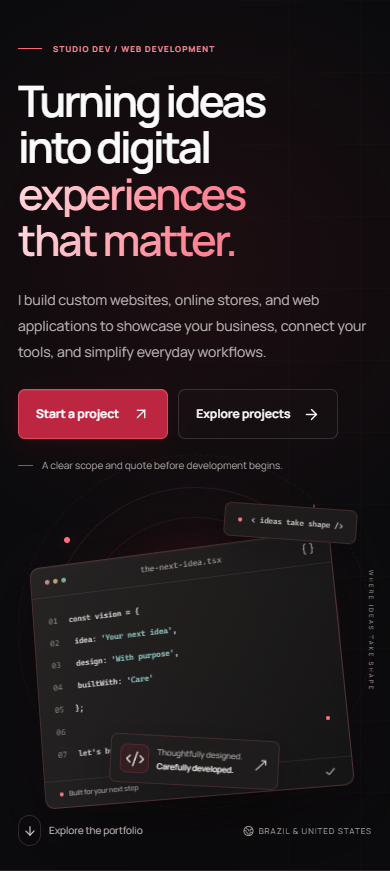

# Studio Dev — Professional Portfolio

Recruiters and prospective clients need a clear view of projects, engineering decisions and evidence without access to proprietary source. Studio Dev is the main portfolio, presenting selected project narratives through a bilingual responsive interface.

**Documentation-only engineering case study. Source code remains proprietary.**

## What was developed

- Portuguese/English routes, project narratives, galleries and privacy pages.
- Responsive dark interface, keyboard navigation, focus restoration and reduced-motion support.
- Project case studies with image provenance and explicit development status.
- Contact draft workflow; server delivery implementation with validation and abuse controls. Public delivery remains disabled pending external setup.
- Metadata, localized URLs and intentional review-mode noindex.

## Technology and technical decisions

Next.js 16.4.2 App Router, React 19.3.1, TypeScript 6, Tailwind CSS, Motion, local Manrope font, Nodemailer, a Redis REST abstraction, Vitest-independent node:test/tsx tests, Playwright and axe.

Long case-study narratives remain outside client bundles. Galleries retain a static fallback. Delivery fails closed when required configuration is absent. Nonce-based script policy and review-mode indexing controls are tested separately from visual behavior.

## Validation

Recorded local verification from **October 29, 2026** (earlier runs, reviewed for this package):

| Check | Result |
|---|---|
| Production webpack build | PASS |
| Server suite | 68 passed |
| Chromium + WebKit compatibility suite | 4 passed; PT/EN, responsive routes, keyboard and draft behavior |
| ESLint | PASS |
| npm dependency audit | 0 reported vulnerabilities |

RC2 evidence dated October 28 records 68 server + 88 browser + 4 compatibility tests, all passing. The earlier October 29 validation reran only 68 server + 4 compatibility tests; do not sum overlapping runs. Lighthouse 13.5.0 / Chrome 156, three local runs per profile: performance median 96 mobile / 100 desktop; accessibility and best practices 100/100; SEO 69/69 with intentional noindex; LCP 2.836 s / 0.648 s, TBT 34 ms / 0 ms and CLS 0. These are historical laboratory measurements, not field performance.

## Interface

Owner-approved historical RC2 local English homepage captures at desktop/mobile widths. They show the portfolio interface, not a hosted deployment. The code-styled hero panel is decorative interface artwork, not an application-source view.

## Development role

Portfolio owner and developer: **Studio Dev (@Studiodev00)**, as identified by the owner of this project. This case study presents implementation and verification evidence. It does not attribute every module exclusively to one person or establish employment, team size or business results from commit history.

## Current boundaries

RC2 is locally verified, not deployed by this work. Privacy identity/retention decisions and external Turnstile/Redis/email configuration remain pending. No real message was sent. Automated WebKit is not a physical Safari/iPhone test. The associated studiodev.dev domain could not be opened through the read-only web check on October 29; no live portfolio link is advertised.

## Source and demonstration availability

This repository contains selected documentation and images only. It is not a buildable source distribution and grants no license to the private application. No binaries, production data or credentials are included. Screenshots appear in the Interface section; a supervised demonstration can be discussed with the project owner. No public application demo has been confirmed for this snapshot.

[Architecture](docs/ARCHITECTURE.md) · [Verified features](docs/FEATURES.md) · [Testing](docs/TESTING.md) · [Security](docs/SECURITY.md) · [Publication review](PUBLICATION_REVIEW.md)

No project source code may be uploaded to GitHub, publicly or privately. Only explicitly approved documentation and authorized images are eligible for publication.
